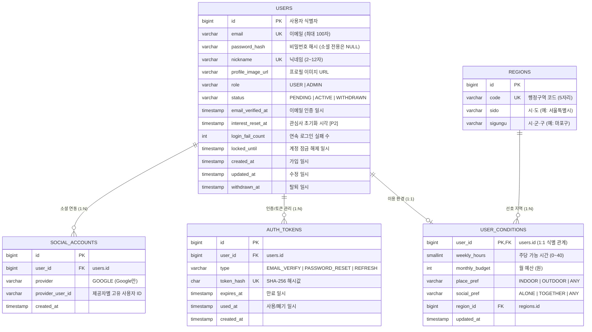
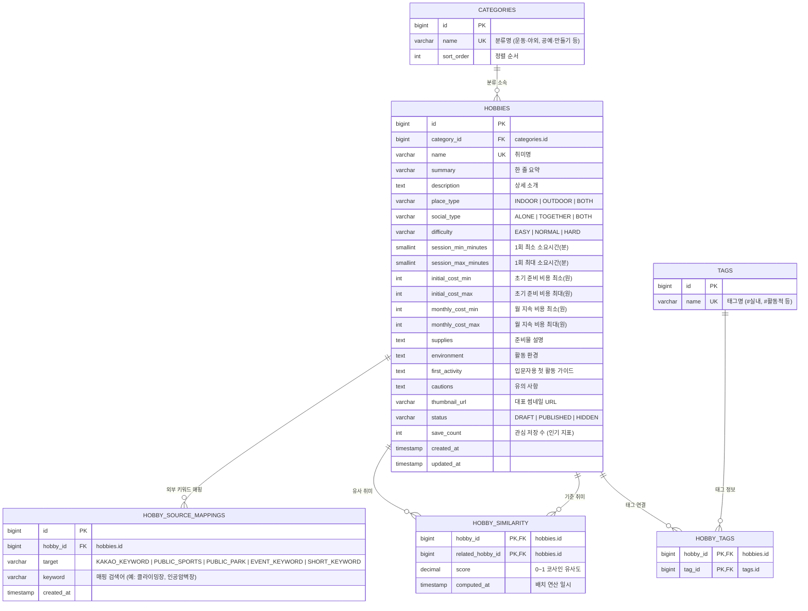
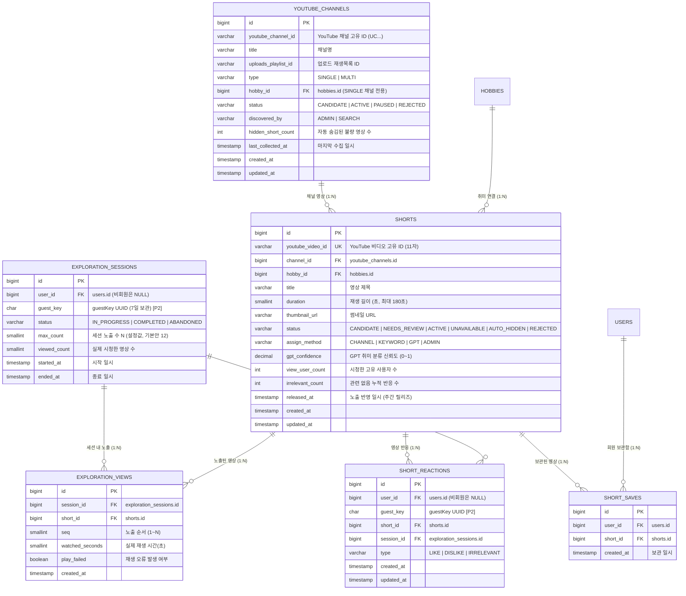
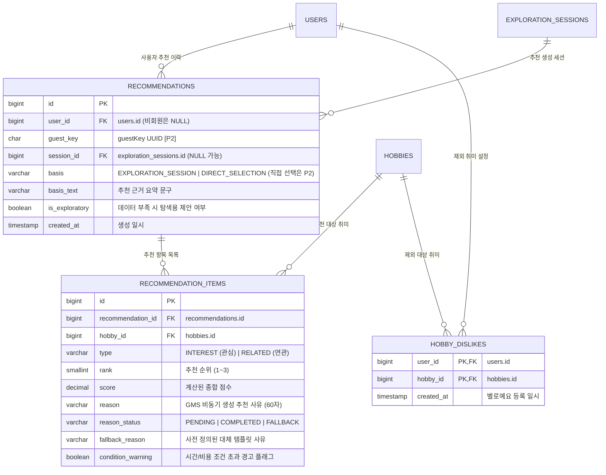
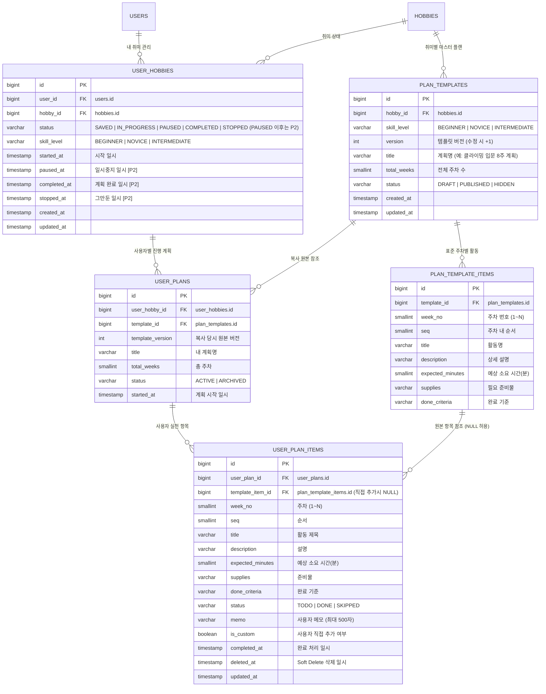
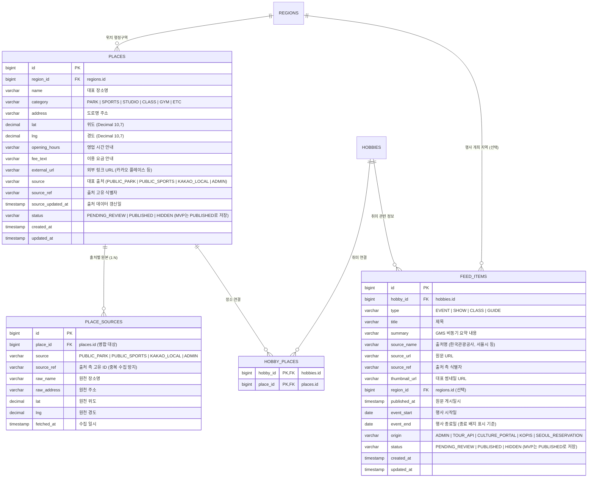

# 냠냠취미 데이터베이스 ERD (Entity Relationship Diagram)

> **기준 스키마**: PostgreSQL 17 · 41개 테이블 · [V1__init.sql](V1__init.sql) (백엔드 `BE/src/main/resources/db/migration/V1__init.sql`과 같은 내용)  
> **타입 표기**: 아래 다이어그램은 PostgreSQL 타입 기준입니다(`timestamp` = TIMESTAMP(6) UTC, `smallint` = MySQL 원안의 TINYINT, `jsonb` = JSON).  
> **프로젝트 명세서**: [spec/project-spec-v0.3.md](../spec/project-spec-v0.3.md) 7장 (데이터 구조)  
> **아키텍처 특징**: 2대 핵심 허브(`users`, `hobbies`)를 중심으로 7개 도메인이 유기적으로 연결된 구조입니다.  
> **기준**: 기능 요구사항 CSV(10/21) 반영 — 스키마는 그대로이며, MVP 제외(P2) 기능(비회원 체험, 관심사 직접 선택·탐색 초기화, 숏폼 보관함, 취미 상태 변경, 내 계획 수정, 알림, 서비스 피드백, 피드·장소 관리자 검토)용 테이블·컬럼은 고도화 대비로 남겨 둡니다. 설명의 `[P2]` 표시는 MVP에서 쓰지 않는다는 뜻입니다.

---

## 1. 전체 도메인 관계도 (High-Level Domain Overview)

전체 41개 테이블은 **회원(`users`)**과 **취미(`hobbies`)**라는 두 개의 중심 엔티티를 허브로 하여 연결됩니다.

```mermaid
erDiagram
    %% 2대 핵심 허브
    USERS ||--o{ SOCIAL_ACCOUNTS : "연동 계정"
    USERS ||--o{ AUTH_TOKENS : "인증/토큰"
    USERS ||--|| USER_CONDITIONS : "이용 환경 설정"
    USERS ||--o{ USER_HOBBIES : "내 취미 (관심/진행)"
    USERS ||--o{ EXPLORATION_SESSIONS : "숏폼 탐색 세션"
    USERS ||--o{ SHORT_REACTIONS : "영상 선호도 반응"
    USERS ||--o{ SHORT_SAVES : "보관한 영상"
    USERS ||--o{ RECOMMENDATIONS : "맞춤 추천 결과"
    USERS ||--o{ HOBBY_DISLIKES : "제외한 취미"
    USERS ||--o{ POSTS : "작성 게시글"
    USERS ||--o{ COMMENTS : "작성 댓글"
    USERS ||--o{ LIKES : "좋아요"
    USERS ||--o{ REPORTS : "신고 접수"
    USERS ||--o{ INQUIRIES : "1:1 문의"
    USERS ||--o{ NOTIFICATIONS : "알림"
    USERS ||--o{ FEEDBACKS : "서비스 피드백"

    CATEGORIES ||--o{ HOBBIES : "상위 분류"
    HOBBIES ||--o{ HOBBY_TAGS : "취미 특성 태그"
    TAGS ||--o{ HOBBY_TAGS : "태그 매핑"
    HOBBIES ||--o{ HOBBY_SIMILARITY : "취미 간 코사인 유사도"
    HOBBIES ||--o{ HOBBY_SOURCE_MAPPINGS : "외부 데이터 검색 매핑"
    HOBBIES ||--o{ SHORTS : "취미 숏폼 영상"
    HOBBIES ||--o{ RECOMMENDATION_ITEMS : "추천 항목"
    HOBBIES ||--o{ USER_HOBBIES : "사용자별 취미 상태"
    HOBBIES ||--o{ PLAN_TEMPLATES : "TODO 마스터 템플릿"
    HOBBIES ||--o{ HOBBY_PLACES : "활동 가능 장소"
    HOBBIES ||--o{ FEED_ITEMS : "행사/강좌 정보 피드"
    HOBBIES ||--o{ POSTS : "취미별 커뮤니티 글"

    REGIONS ||--o{ USER_CONDITIONS : "선호 지역"
    REGIONS ||--o{ PLACES : "장소 위치"

    USER_HOBBIES ||--o{ USER_PLANS : "사용자 복제 계획"
    PLAN_TEMPLATES ||--o{ USER_PLANS : "원본 참조"
    PLAN_TEMPLATES ||--o{ PLAN_TEMPLATE_ITEMS : "주차별 표준 활동"
    USER_PLANS ||--o{ USER_PLAN_ITEMS : "주차별 실천 활동"

    PLACES ||--o{ HOBBY_PLACES : "취미 연결"
    PLACES ||--o{ PLACE_SOURCES : "출처별 원본 (병합)"

    EXPLORATION_SESSIONS ||--o{ EXPLORATION_VIEWS : "영상 노출/시청"
    SHORTS ||--o{ EXPLORATION_VIEWS : "시청 기록"
    SHORTS ||--o{ SHORT_REACTIONS : "반응 대상"
    SHORTS ||--o{ SHORT_SAVES : "보관 대상"

    RECOMMENDATIONS ||--o{ RECOMMENDATION_ITEMS : "추천 리스트"

    POSTS ||--o{ POST_IMAGES : "첨부 이미지"
    POSTS ||--o{ COMMENTS : "댓글 목록"
    COMMENTS ||--o{ COMMENTS : "대댓글 (1단계)"
```

---

## 2. 도메인별 상세 ERD

---

### 2.1 회원 및 프로필 도메인 (Auth & User Profile)
- **비회원 식별** `[P2]`: `guest_key` (UUID)를 통해 비회원 체험 데이터를 추적하며, 회원가입 시 `users` 계정으로 통합 이관됩니다. 비회원 체험이 MVP 제외라 MVP에서는 쓰지 않습니다.
- **소셜 연동** `[P1]`: 구글 계정 식별 정보를 `social_accounts`에서 관리합니다(소셜 로그인은 Google만).

---

### 2.2 취미 콘텐츠 및 메타데이터 도메인 (Hobby & Taxonomy)
- **유사도 매트릭스**: Spring 일 배치(`@Scheduled`)가 태그 벡터 기반 코사인 유사도를 계산하여 `hobby_similarity`에 저장합니다.
- **외부 데이터 매핑**: 외부 수집 배치(카카오맵, 공공데이터, TourAPI)에서 취미별 검색 키워드를 `hobby_source_mappings`로 정규화합니다.

---

### 2.3 숏폼 탐색 및 반응 도메인 (Short-form Exploration & Reactions)
- **생명주기 관리**: 영상은 `CANDIDATE` 수집 후 주간 반영을 거쳐 `ACTIVE`로 전환되며, 사용자 신고 누적 시 `AUTO_HIDDEN` 처리됩니다. 수집 배치(P0)가 불확실한 영상은 `NEEDS_REVIEW`로 저장하며, 이 영상은 관리자가 승인할 때까지 반영(노출)하지 않습니다(승인 → `CANDIDATE` → 다음 주간 반영 때 `ACTIVE`, 거절 → `REJECTED`). 관리자 숏폼 검수 화면(채널 승인·영상 검토·자동 숨김 복구)은 `[P3]`이고, 그 전에는 DB에서 직접 합니다. 확실한 영상은 관리자 없이 주간 반영으로 노출됩니다.
- **보관함·직접 선택** `[P2]`: `short_saves`(숏폼 보관함)와 `interest_selections`(관심사 직접 선택)는 MVP에서 쓰지 않습니다.
- **점수 산출**: 시청 시간(`watched_seconds`)과 반응(`LIKE`/`DISLIKE`)을 통해 실시간 취향 점수를 도출합니다.

---

### 2.4 추천 및 선호도 도메인 (Recommendation & Preference)
- **추천 스냅샷**: 한 번 생성된 추천 결과는 `recommendations` 및 `recommendation_items`에 스냅샷으로 저장되어 일관성을 보장합니다.
- **비동기 추천 사유**: 추천 생성 직후 RabbitMQ를 통해 GMS(GPT-4o)가 60자 이내의 설득력 있는 맞춤 사유를 생성하여 갱신합니다.

---

### 2.5 내 취미 및 주차별 TODO 도메인 (User Hobby & TODO Plans)
- **템플릿-인스턴스 분리 (Copy-on-Start)**: 관리자가 작성한 마스터 템플릿(`plan_templates`, `plan_template_items`)을 사용자가 '시작하기'를 누를 때 사용자 전용 사본(`user_plans`, `user_plan_items`)으로 통째로 복사합니다. 이를 통해 원본 변경이나 타 사용자와 무관하게 독립적인 커스텀(활동 추가/삭제/수정, 내 계획 수정은 `[P2]`)이 가능합니다. MVP에서 마스터 템플릿은 관리자 화면(`[P2]`) 대신 시드 SQL로 넣습니다.
- **취미 상태 변경** `[P2]`: `PAUSED`·`COMPLETED`·`STOPPED`와 일시중지 관련 컬럼은 MVP에서 쓰지 않습니다(MVP는 `SAVED`·`IN_PROGRESS`, 동시 진행 최대 5개).

---

### 2.6 활동 장소 및 정보 피드 도메인 (Places & Feed Items)
- **장소 중복 병합 (Deduplication)**: 여러 출처(공공체육시설, 공원, 카카오 로컬)에서 수집된 장소 원본은 `place_sources`에 보존하고, 좌표(50m 이내)와 상호명 유사도(0.6 이상)를 검사하여 단일 대표 장소(`places`)로 통합합니다.
- **공개 상태**: 관리자 검토(`[P2]`)가 MVP 제외라 배치로 들어온 장소·정보 피드는 `PENDING_REVIEW`를 거치지 않고 바로 `PUBLISHED`로 저장합니다(검토 단계는 P2 도입 시).

---

### 2.7 커뮤니티, 고객센터 및 운영 도메인 (Community & Administration)
- **다형성 참조**: `likes`(좋아요)와 `reports`(신고)는 특정 테이블에 종속되지 않고 `(target_type, target_id)` 다형성 키로 `POST`, `COMMENT`, `SHORT`를 유연하게 가리킵니다.
- **대댓글 1단계 제한**: `comments.parent_id`의 자기 참조를 통해 대댓글을 지원하되, 비즈니스 규칙상 1단계까지만 허용합니다.
- **우선순위**: 게시판·댓글·좋아요는 `[P1]`, 신고·문의·공지는 `[P3]`, `notifications`(웹 알림)와 `feedbacks`(서비스 피드백)는 `[P2]`(MVP 제외)입니다.

```mermaid
erDiagram
    HOBBIES ||--o{ POSTS : "게시판 소속"
    USERS ||--o{ POSTS : "작성자"
    POSTS ||--o{ POST_IMAGES : "본문 첨부 이미지"
    POSTS ||--o{ COMMENTS : "게시글 댓글"
    USERS ||--o{ COMMENTS : "댓글 작성자"
    COMMENTS ||--o{ COMMENTS : "대댓글 (자기 참조 1단계)"
    USERS ||--o{ LIKES : "좋아요 주체"
    USERS ||--o{ REPORTS : "신고 접수자"
    USERS ||--o{ INQUIRIES : "문의자"
    INQUIRIES ||--o| INQUIRY_ANSWERS : "관리자 답변 (1:1)"
    USERS ||--o{ INQUIRY_ANSWERS : "답변 관리자"
    USERS ||--o{ NOTICES : "공지 작성 관리자"
    USERS ||--o{ NOTIFICATIONS : "알림 수신자"
    USERS ||--o{ FEEDBACKS : "피드백 작성자"

    POSTS {
        bigint id PK
        bigint hobby_id FK "hobbies.id"
        bigint user_id FK "users.id"
        varchar type "QUESTION | INFO | REVIEW | SHARE"
        varchar title "게시글 제목"
        text content "게시글 본문 (N-gram 전문 검색 지원)"
        int view_count "조회수"
        int like_count "좋아요 수"
        int comment_count "댓글 수"
        varchar status "ACTIVE | HIDDEN | DELETED"
        timestamp created_at
        timestamp updated_at
    }

    POST_IMAGES {
        bigint id PK
        bigint post_id FK "posts.id"
        varchar url "이미지 CDN URL"
        smallint seq "노출 순서"
    }

    COMMENTS {
        bigint id PK
        bigint post_id FK "posts.id"
        bigint user_id FK "users.id"
        bigint parent_id FK "comments.id (대댓글인 경우 부모 ID)"
        varchar content "댓글 내용"
        int like_count "좋아요 수"
        varchar status "ACTIVE | HIDDEN | DELETED"
        timestamp created_at
        timestamp updated_at
    }

    LIKES {
        bigint id PK
        bigint user_id FK "users.id"
        varchar target_type "POST | COMMENT"
        bigint target_id "대상 식별자"
        timestamp created_at
    }

    REPORTS {
        bigint id PK
        bigint reporter_id FK "users.id"
        varchar target_type "POST | COMMENT | SHORT"
        bigint target_id "신고 대상 식별자"
        varchar reason "SPAM | ABUSE | ADULT | PRIVACY | ETC"
        varchar detail "상세 신고 사유"
        varchar status "RECEIVED | ACTIONED | DISMISSED"
        varchar action "HIDE | RESTORE | DISMISS"
        varchar admin_note "관리자 처리 메모"
        timestamp actioned_at "조치 일시"
        timestamp created_at
    }

    INQUIRIES {
        bigint id PK
        bigint user_id FK "users.id"
        varchar category "ACCOUNT | SERVICE | CONTENT | BUG | ETC"
        varchar title "문의 제목"
        text content "문의 내용"
        varchar status "RECEIVED | ANSWERED"
        timestamp created_at
        timestamp updated_at
    }

    INQUIRY_ANSWERS {
        bigint id PK
        bigint inquiry_id UK, FK "inquiries.id (1:1)"
        bigint admin_id FK "users.id"
        text content "답변 내용"
        timestamp created_at
        timestamp updated_at
    }

    NOTICES {
        bigint id PK
        bigint admin_id FK "users.id"
        varchar category "GUIDE | MAINTENANCE | UPDATE"
        varchar title "공지 제목"
        text content "공지 본문"
        boolean pinned "상단 고정 여부"
        varchar status "DRAFT | PUBLISHED"
        timestamp published_at "게시 일시"
        timestamp created_at
        timestamp updated_at
    }

    NOTIFICATIONS {
        bigint id PK
        bigint user_id FK "users.id"
        varchar type "COMMENT | REPLY | INQUIRY_ANSWERED | REPORT_DONE | NOTICE | WEEKLY_TODO | NEW_FEED"
        varchar title "알림 제목"
        varchar message "알림 메시지"
        varchar link_url "이동 URL 링크"
        boolean is_read "읽음 여부"
        varchar dedup_key UK "중복 발송 방지 키"
        timestamp created_at
    }

    FEEDBACKS {
        bigint id PK
        bigint user_id FK "users.id"
        varchar category "BUG | RECOMMEND | CONTENT | SUGGESTION | ETC"
        varchar content "피드백 내용"
        varchar page_path "제출 당시 화면 경로"
        jsonb client_info "브라우저 및 클라이언트 메타"
        varchar status "RECEIVED | ANALYZING | ANALYZED | ANALYSIS_FAILED"
        varchar priority "URGENT | HIGH | NORMAL | LOW (AI 분류)"
        varchar ai_category "AI 재분류 카테고리"
        varchar ai_summary "GMS 요약 내용"
        timestamp notified_at "Mattermost 웹훅 통지 일시"
        timestamp created_at
    }

    BATCH_RUNS {
        bigint id PK
        varchar job "SHORT_COLLECT | SHORT_CHECK | SHORT_RELEASE | PLACE_PUBLIC | PLACE_KAKAO | FEED_COLLECT 등"
        varchar status "RUNNING | SUCCESS | PARTIAL | FAILED"
        int processed "조회 대상 건수"
        int accepted "저장/반영 성공 건수"
        int rejected "필터링 제외 건수"
        int quota_used "외부 API 쿼터 소모량"
        varchar message "결과 또는 오류 메시지"
        timestamp started_at "시작 일시"
        timestamp finished_at "종료 일시"
    }

    EVENT_LOGS {
        bigint id PK
        bigint user_id FK "users.id (비회원은 NULL)"
        char guest_key "guestKey UUID [P2]"
        varchar event_type "RECO_IMPRESSION | RECO_CLICK | HOBBY_SAVE | HOBBY_START | HOBBY_DISLIKE"
        varchar target_type "대상 유형"
        bigint target_id "대상 ID"
        jsonb meta "이벤트 메타데이터"
        timestamp created_at
    }
```

---

## 3. 핵심 설계 원칙 및 주의점

1. **JPA ddl-auto 검증 일치성**:
   - 모든 엔티티의 컬럼명과 타입은 [V1__init.sql](V1__init.sql)의 정의와 100% 일치해야 하며, `ddl-auto: validate` 환경에서 통과하도록 `@Column`, `@Enumerated(EnumType.STRING)` 설정을 엄격히 준수합니다.
2. **다형성 외래키 처리**:
   - `likes`, `reports`, `event_logs`의 `target_type`과 `target_id`는 물리적 FK가 아닌 애플리케이션 레벨의 복합 유니크 키(`uk_likes_target`, `uk_report_target`)로 정합성을 유지합니다.
3. **비회원/회원 데이터 모델 통합** `[P2]`:
   - `exploration_sessions`, `short_reactions`, `recommendations`, `event_logs`는 `user_id`와 `guest_key`를 병행 지원하며, 회원가입 시 1회 이관(Merge) 로직을 거칩니다. 비회원 체험이 MVP 제외(P2)라 MVP에서는 항상 `user_id`만 채우고, 컬럼은 도입에 대비해 남겨 둡니다.
4. **TODO 원본과 복제 계획의 생명주기 격리**:
   - 마스터 템플릿(`plan_templates`)이 수정되어도 이미 진행 중인 사용자의 계획(`user_plans`)은 시작 시점의 스냅샷 버전을 유지합니다.
